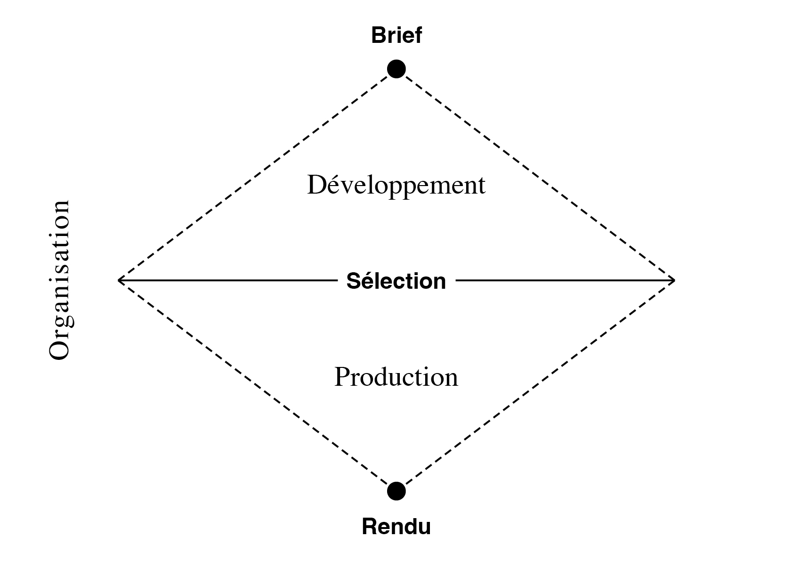
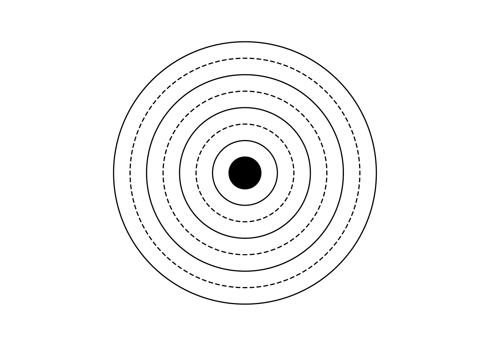
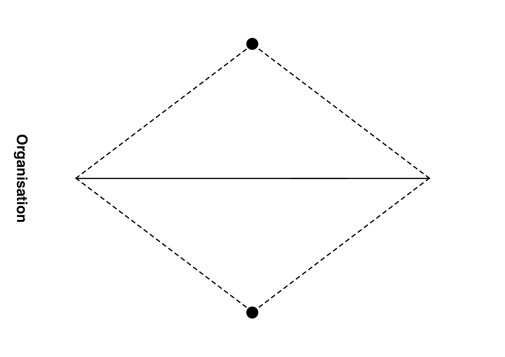
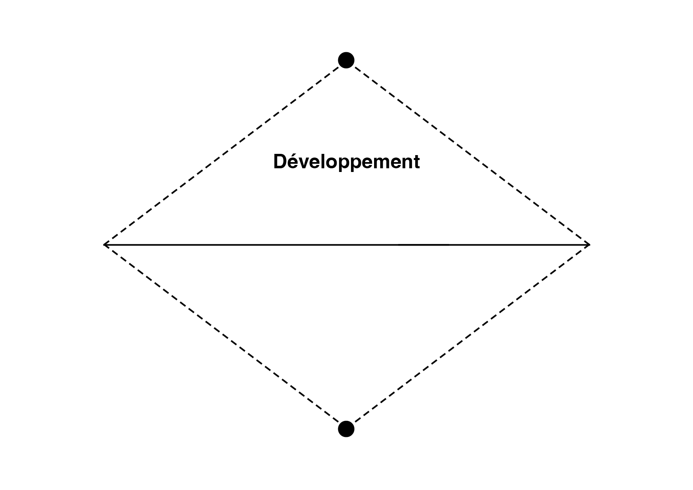
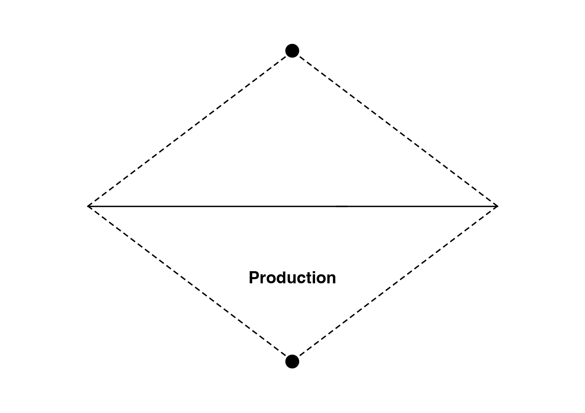

# 📶 Critères d’évaluation

### &nbsp;

# Exercice

  
  <!--
    ============================================================
    TABLEAUX — textes à modifier directement ici
    - Ligne de critère : <tr class="crit-row" data-export="…">
        • texte du titre dans 
        • data-export = nom utilisé dans l'export
    - Ligne de sous-critère :
        • 1re cellule = titre
        • 2e cellule = question
        • data-export (3e cellule) = nom utilisé dans l'export
    Pour ajouter / retirer un sous-critère : copier / supprimer une ligne.
    La case Note doit rester dans la première ligne de critère.
    ============================================================
  -->
  <!-- ======================= TABLEAU EXERCICE ======================= -->
  <table class="eval-table">
    <colgroup>
      <col style="width:20%">
      <col>
      <col style="width:32%">
      <col style="width:16%">
    </colgroup>
    <thead>
      <tr>
        <th>Critère</th>
        <th>Question</th>
        <th>Évaluation</th>
        <th>Note</th>
      </tr>
    </thead>
    <tbody>
      <!-- DESIGN -->
      <tr class="crit-row" data-export="design">
        <td colspan="3">Design</td>
        <td class="note-cell">
          

          
0.00

          
<button class="save-btn" type="button"></button>

        </td>
      </tr>
      <tr>
        <td class="sub-label">Pertinence contextuelle</td>
        <td class="question">La solution graphique est-elle pertinente par rapport au contexte donné ?</td>
        <td class="rating" data-export="contexte"></td>
      </tr>
      <tr>
        <td class="sub-label">Hiérarchie</td>
        <td class="question">La hiérarchie est-elle claire, le message principal ressort-il ?</td>
        <td class="rating" data-export="hiérarchie"></td>
      </tr>
      <tr>
        <td class="sub-label">Impact</td>
        <td class="question">Le travail capte-t-il l’attention et marque-t-il durablement ?</td>
        <td class="rating" data-export="impact"></td>
      </tr>
      <!-- PROCESSUS -->
      <tr class="crit-row" data-export="processus">
        <td colspan="3">Processus</td>
      </tr>
      <tr>
        <td class="sub-label">Intentions claires</td>
        <td class="question">Les intentions sont-elles clairement définies et argumentées ?</td>
        <td class="rating" data-export="intentions"></td>
      </tr>
      <tr>
        <td class="sub-label">Organisation</td>
        <td class="question">Le temps, le matériel et les délais sont-ils bien gérés ?</td>
        <td class="rating" data-export="organisation"></td>
      </tr>
      <tr>
        <td class="sub-label">Recherche</td>
        <td class="question">La recherche est-elle variée, itérative et menée avec un regard critique ?</td>
        <td class="rating" data-export="recherche"></td>
      </tr>
      <!-- TECHNIQUE -->
      <tr class="crit-row" data-export="technique">
        <td colspan="3">Technique</td>
      </tr>
      <tr>
        <td class="sub-label">Précision</td>
        <td class="question">L’exécution est-elle précise et soignée ?</td>
        <td class="rating" data-export="précision"></td>
      </tr>
      <tr>
        <td class="sub-label">Production</td>
        <td class="question">La production finale est-elle aboutie et bien réalisée ?</td>
        <td class="rating" data-export="production"></td>
      </tr>
      <tr>
        <td class="sub-label">Systématisation</td>
        <td class="question">Les règles (grille, typographie, couleurs) sont-elles appliquées de manière cohérente ?</td>
        <td class="rating" data-export="systématisation"></td>
      </tr>
    </tbody>
  </table>

# Projet

  <!-- ======================= TABLEAU PROJET ======================= -->
  <table class="eval-table">
    <colgroup>
      <col style="width:20%">
      <col>
      <col style="width:32%">
      <col style="width:16%">
    </colgroup>
    <thead>
      <tr>
        <th>Critère</th>
        <th>Question</th>
        <th>Évaluation</th>
        <th>Note</th>
      </tr>
    </thead>
    <tbody>
      <!-- DESIGN -->
      <tr class="crit-row" data-export="design">
        <td colspan="3">Design</td>
        <td class="note-cell">
          

          
0.00

          
<button class="save-btn" type="button"></button>

        </td>
      </tr>
      <tr>
        <td class="sub-label">Pertinence contextuelle</td>
        <td class="question">La solution graphique est-elle pertinente par rapport au contexte donné ?</td>
        <td class="rating" data-export="contexte"></td>
      </tr>
      <tr>
        <td class="sub-label">Hiérarchie</td>
        <td class="question">La hiérarchie est-elle claire, le message principal ressort-il ?</td>
        <td class="rating" data-export="hiérarchie"></td>
      </tr>
      <tr>
        <td class="sub-label">Impact</td>
        <td class="question">Le travail capte-t-il l’attention et marque-t-il durablement ?</td>
        <td class="rating" data-export="impact"></td>
      </tr>
      <!-- PROCESSUS -->
      <tr class="crit-row" data-export="processus">
        <td colspan="3">Processus</td>
      </tr>
      <tr>
        <td class="sub-label">Intentions claires</td>
        <td class="question">Les intentions sont-elles clairement définies et argumentées ?</td>
        <td class="rating" data-export="intentions"></td>
      </tr>
      <tr>
        <td class="sub-label">Organisation</td>
        <td class="question">Le temps, le matériel et les délais sont-ils bien gérés ?</td>
        <td class="rating" data-export="organisation"></td>
      </tr>
      <tr>
        <td class="sub-label">Recherche</td>
        <td class="question">La recherche est-elle variée, itérative et menée avec un regard critique ?</td>
        <td class="rating" data-export="recherche"></td>
      </tr>
      <!-- TECHNIQUE -->
      <tr class="crit-row" data-export="technique">
        <td colspan="3">Technique</td>
      </tr>
      <tr>
        <td class="sub-label">Précision</td>
        <td class="question">L’exécution est-elle précise et soignée ?</td>
        <td class="rating" data-export="précision"></td>
      </tr>
      <tr>
        <td class="sub-label">Production</td>
        <td class="question">La production finale est-elle aboutie et bien réalisée ?</td>
        <td class="rating" data-export="production"></td>
      </tr>
      <tr>
        <td class="sub-label">Systématisation</td>
        <td class="question">Les règles (grille, typographie, couleurs) sont-elles appliquées de manière cohérente ?</td>
        <td class="rating" data-export="systématisation"></td>
      </tr>
    </tbody>
  </table>
  

<!-- ### &nbsp;

| |
|:---:|
| Processus: organisation, développement, production |  -->

<!-- # Exercice technique  

| |
|:---:|
| Juste ou faux |  -->

<!-- ## 6 pts Organisation (gestion)  

| |
|:---:|
| Autonomie, compréhension du brief, gestion du temps et du matériel | 

## 6 pts Développement (quantité)  

| |
|:---:|
| Recherche, itérations, variété, regard critique | 

## 6 pts Production (qualité)  

| |
|:---:|
| Synthèse, impact graphique, propreté technique |  -->
