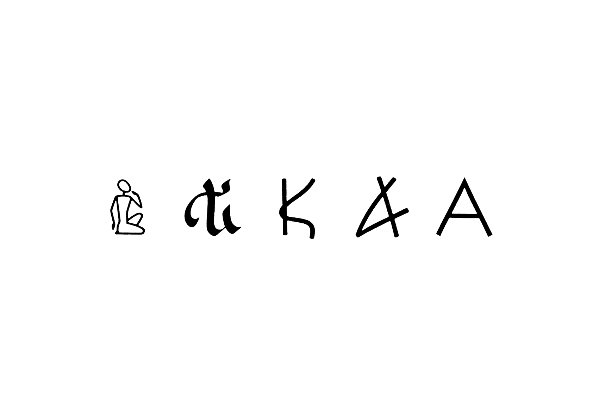
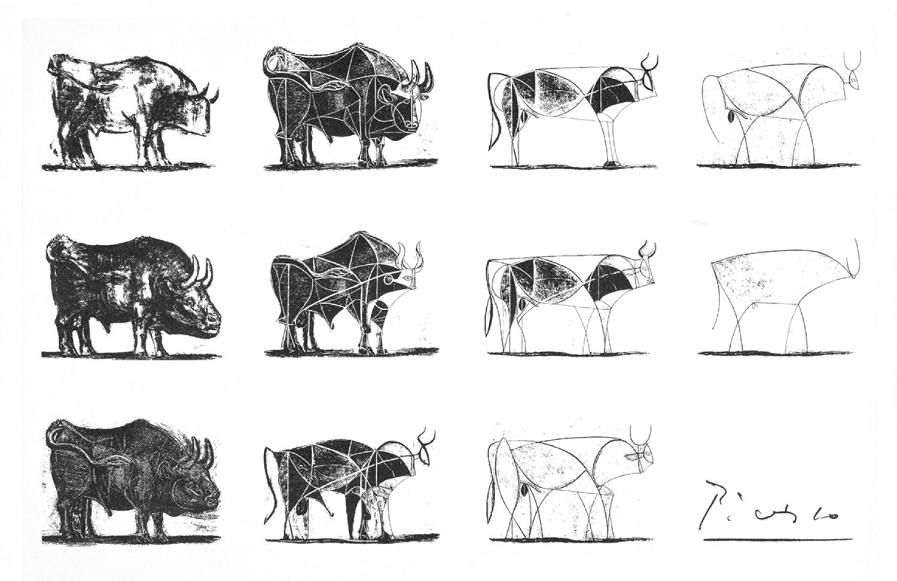
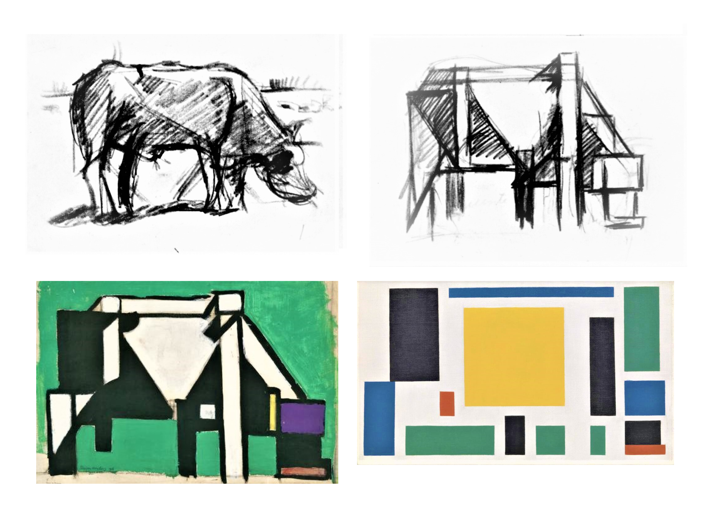
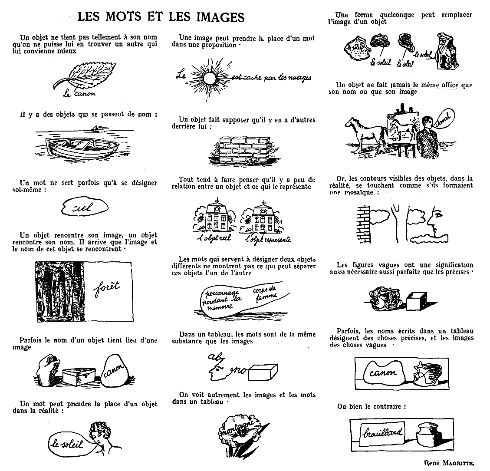
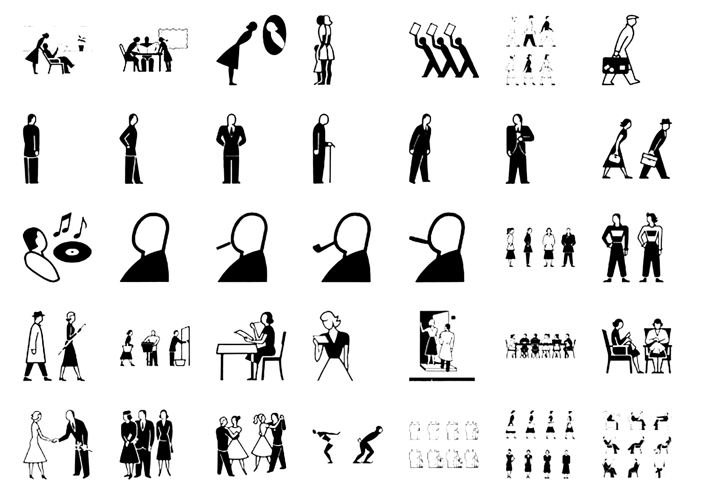
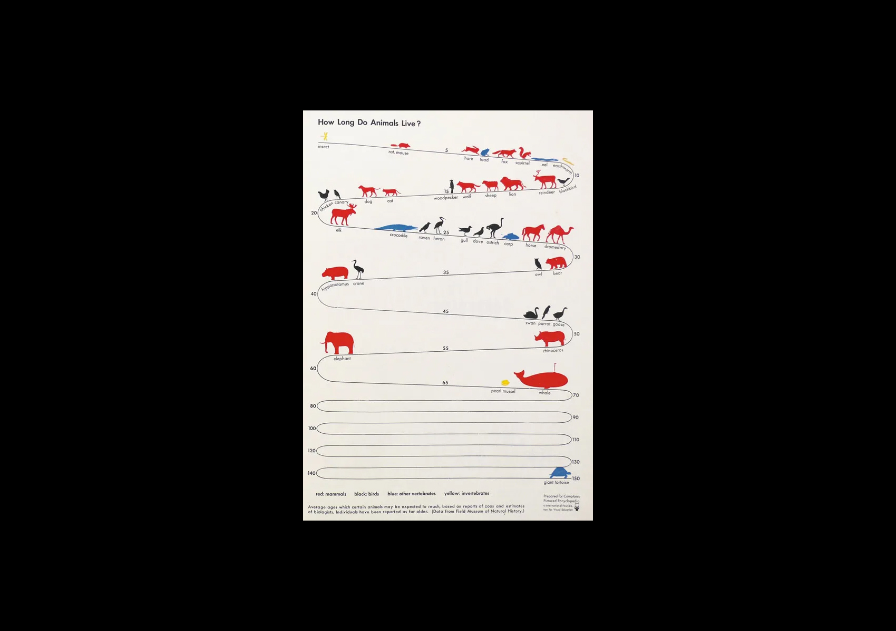
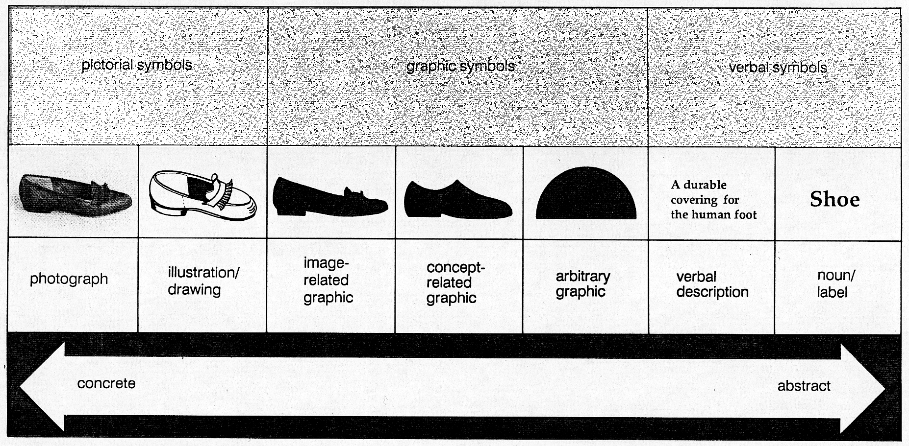
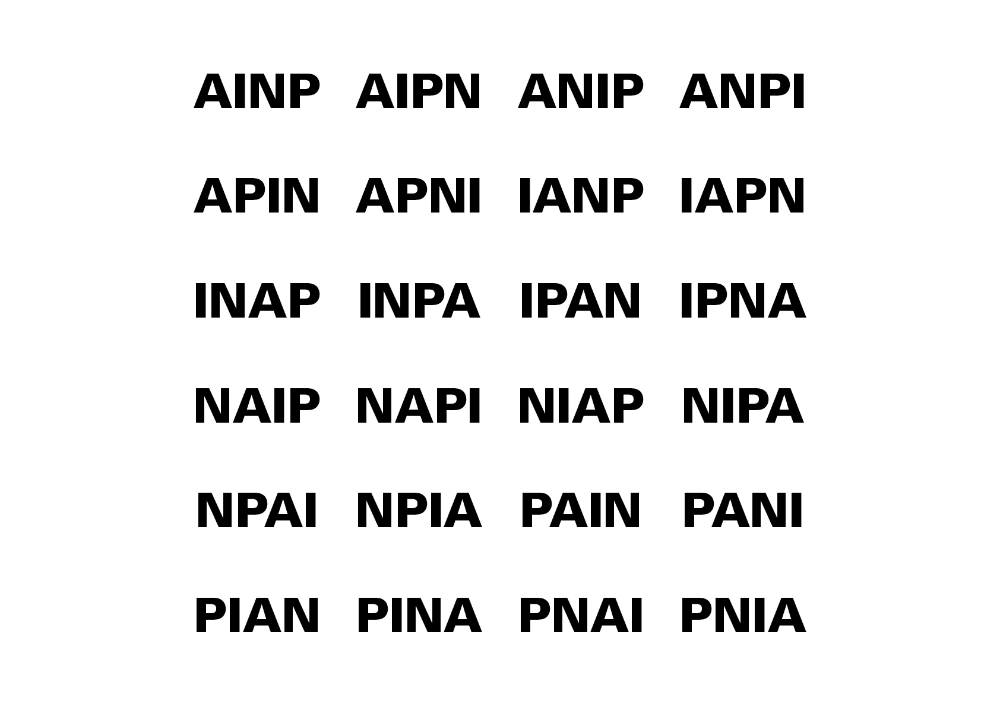

# 🚸 Iconicité

- [Figuration-Abstraction](#figuration-abstraction)
- [Mot-Image](#mot-image)
- [Isotype](#isotype)
- [Échelle d’iconicité de Wileman](#wileman-iconicite)
<!-- - [Échelle d’iconicité de Moles](#wileman-iconicite) -->

&nbsp;

||
|:---:|
| Hans-Rudolf Lutz, Évolution de l'écriture dans *Ausbildung in typografischer Gestaltung*, 1980  |

# Figuration-Abstraction {#figuration-abstraction}

||
|:---:|
| Pablo Picasso, *Étude de taureau*, 1945-1946 |

||
|:---:|
| Theo Van Doesburg, *La vache*, 1918 |

# Mot-Image {#mot-image}

||
|:---:|
| René Magritte, *Les mots et les images*, 1929 |

# Isotype {#isotype}

||
|:---:|
| Otto Neurath, Marie Neurath, Gerd Arntz, *Isotype (en anglais : International System Of TYpographic Picture Education, litt. « Système international d'éducation par les images typographiques »)*, 1925 |

||
|:---:|
| Otto Neurath, Marie Neurath, Gerd Arntz, *How Long Do Animals Live?*, 1939 |

# Échelle d’iconicité {#wileman-iconicite}

||
|:---:|
| Ralph E. Wileman, *Échelle d’iconicité* |

1. Signe pictural (concret)  
1.1. Photographie  
1.2. Illustration  
2. Signe graphique (concret-abstrait)  
2.1. Icône basée sur la silhouette  
2.2. Icône basée sur les propriétés  
2.3. Icône arbitraire  
2. Signe verbal (abstrait)  
3.1. Description  
3.2. Nom  

||
|:---:|
| Abraham Moles, *Échelle d’iconicité*, 1971 dans *Les Images démaquillées* de Claude Cossette, 1983 |

<!-- # Échelle d’iconicité de Moles {#moles-iconicite}

||
|:---:|
| Abraham Moles, *Échelle d’iconicité* |

||
|:---:|
| Abraham Moles, *Échelle d’iconicité* |

1. Objet
--------------------
2. Photographie
3. Illustration
4. Dessin / Schéma
5. Pictogramme
6. Diagramme
7. Idéogramme
8. Mot-Image
9. Onomatopée
10. Mot arbitraire
11. Symbole abstrait
12. Symbole tacite -->

<!-- ### Sources

- Hans-Rudolf Lutz, *Ausbildung in typografischer Gestaltung*, Zurich: Hans-Rudolf Lutz Verlag, 1980  
- Wileman
- Abraham Moles, *Les sciences de l’imprécis: Échelles d’iconicité*, Paris: Seuil, 1990   
- Adrian Frutiger, *Type Sign Symbol*, Zurich: ABC Verlag, 1980   -->

